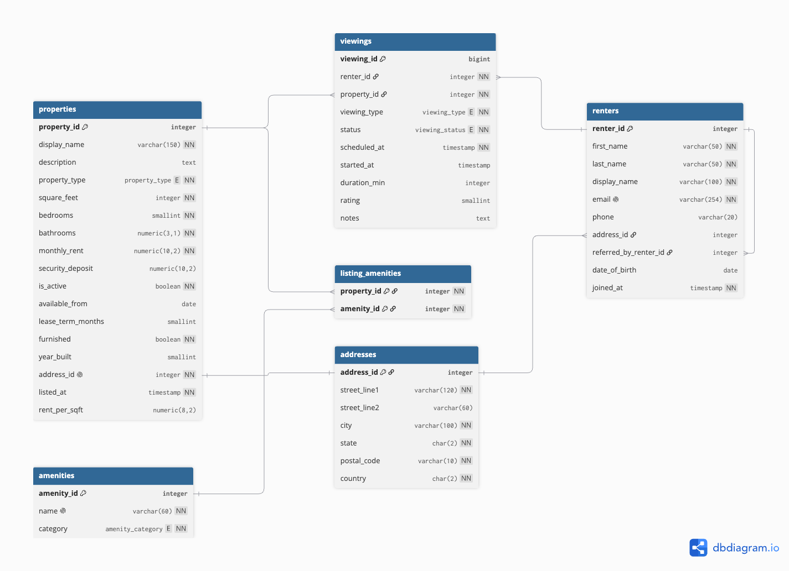

# EX 603 — Rental Marketplace Database

**Author:** Admas
**Theme:** Rental Marketplace (theme 4)

This project is a PostgreSQL database for a rental marketplace. It tracks renters, the properties they are interested in, the viewings they schedule, and the amenities associated with each listing. The goal is to have a schema that can answer practical marketplace questions around listing demand, renter behavior, and which property features drive the most interest.

All renter and property data in this repository is synthetic. No real people or addresses are used.

## The domain

The marketplace has two main sides: properties and renters.

Properties are the rental listings available on the platform. Each property has an address, physical details such as bedrooms, bathrooms, size, and property type, as well as rental terms such as monthly rent, security deposit, lease length, and available move-in date. A property can be active or retired, but it is not deleted when it leaves the marketplace because its historical activity is still useful.

Renters are the users looking for a place to live. They create accounts and schedule viewings for properties they are interested in.

The main activity in the system is a viewing. A viewing connects a renter to a property at a specific date and time. It can be in-person, virtual, or self-guided and can end as completed, cancelled, no-show, or remain scheduled. For completed viewings, the system also records how long the viewing lasted and optionally the renter's rating.

I treat viewings as the fact table because it is where most of the activity and data volume will be. The number of renters and properties should grow relatively slowly, while the platform could generate thousands of viewing records per day.

This structure lets the database answer questions that would matter to someone operating the marketplace. For example: Which properties are getting the most viewings? Are virtual viewings shorter than in-person ones? Does viewing duration correlate with renter interest? Which amenities are associated with longer viewings? How does the rent-to-deposit ratio differ across property types? How does viewing activity change by day of the week or throughout the year?

Most of these questions come back to querying viewings, joining them to properties, and using listing_amenities when property features are part of the analysis.

## Schema



The database has six relations: the five roles required by the theme and one supporting relation.

| Role       | Relation            | Primary key                 | Purpose                                                                 |
| ---------- | ------------------- | --------------------------- | ----------------------------------------------------------------------- |
| actor      | `renters`           | `renter_id`                 | Renters who book property viewings; supports referrals between renters  |
| producer   | `properties`        | `property_id`               | Rental listings, including rent, availability, and rent per square foot |
| event      | `viewings`          | `viewing_id`                | One row for each scheduled property viewing                             |
| catalog    | `amenities`         | `amenity_id`                | Features used to describe and classify listings                         |
| junction   | `listing_amenities` | `(property_id, amenity_id)` | Many-to-many link between listings and amenities                        |
| supporting | `addresses`         | `address_id`                | Shared address structure for both renters and properties                |

Design decisions a reader should notice:

- **Surrogate keys are used everywhere except the junction table.** This keeps foreign keys stable even if something like an email or amenity name changes. `email` and `amenities.name` are still unique, but they are treated as candidate keys rather than primary keys.

- **There are three different `ON DELETE` behaviors: `SET NULL`, `RESTRICT`, and `CASCADE`.** The choice depends on what should happen to the child when its parent is removed. Viewings are kept as historical records, so they are never deleted with a renter or property. Listings are normally retired using `is_active` instead of being deleted. The full breakdown is in [`analysis/unit2.md`](analysis/unit2.md).

- **`duration_min` is populated only when a viewing is `completed`.** Two table-level `CHECK` constraints enforce this so later aggregate queries do not silently use incomplete or invalid viewing data.

- **`renters` has a recursive foreign key for referrals.** `referred_by_renter_id` points back to another renter, with a `CHECK` constraint preventing someone from referring themselves.

- **`rent_per_sqft` is a stored generated column.** Since this is something renters could sort or filter listings by, storing the generated value also gives the option to index it.

- **Closed vocabularies use `CHECK` constraints instead of separate lookup tables.** These lists are short and stable, and they do not have any additional attributes that would justify their own tables.

- **Every constraint is named** using `pk_`, `fk_`, `uq_`, and `chk_` prefixes. This makes constraint violations much easier to understand when something fails.

## Query catalogue

Unit 3 and later queries run against the course reference dataset (see [How to run it](#how-to-run-it)).

| Unit | File | Business question |
| ---- | ---- | ----------------- |
| 3 | [`q3_1.sql`](queries/unit3/q3_1.sql) | Which available properties are cheapest, which viewing statuses and reasons exist, and which viewings fall in a duration range or were cancelled by the renter? |
| 3 | [`q3_1.sql`](queries/unit3/q3_1.sql) | How do missing reasons and raw viewing records read to a non-technical user, and how can `COALESCE` and `CASE` make them clearer? |
| 3 | [`q3_2.sql`](queries/unit3/q3_2.sql) | Why did the dashboard report a 44% no-show rate, and what is the correct rate once missing reasons are handled properly? |
| 3 | [`q3_2.sql`](queries/unit3/q3_2.sql) | Which viewings started more than 30 minutes late, and why can't `WHERE` use a `SELECT` alias? |
| 3 | [`q3_3.sql`](queries/unit3/q3_3.sql) | Which renters were involved in a disputed viewing, and do `IN`, a CTE and `EXISTS` return the same answer? |
| 4 | [`q4_1.sql`](queries/unit4/q4_1.sql) | What does the platform look like overall (count, total, average, min and max viewing duration, distinct renters), and why is the minimum zero? |
| 4 | [`q4_1.sql`](queries/unit4/q4_1.sql) | How many viewings does each property get and how long do they last, and which properties have enough viewings (10+) to judge? |
| 4 | [`q4_1.sql`](queries/unit4/q4_1.sql) | How does activity break down by region and viewing outcome together? |
| 4 | [`q4_2.sql`](queries/unit4/q4_2.sql) | For each property, how many viewings could have been a no-show, and how many were? |
| 4 | [`q4_2.sql`](queries/unit4/q4_2.sql) | What is the no-show rate per region, and for the platform as a whole? |
| 4 | [`q4_2.sql`](queries/unit4/q4_2.sql) | What is a normal no-show rate for high-volume properties, and how far above it is the worst one? |

Write-ups: [Unit 1](analysis/unit1.md) · [Unit 2](analysis/unit2.md) · [Unit 3 finding](analysis/unit3-finding.md) · [Unit 4](analysis/unit4.md) · [Unit 4 finding](analysis/unit4-finding.md)

## Technical highlights

## Technical highlights

- **NULL-safe filtering (Unit 3).** The dashboard's 44% no-show rate came from `no_show_reason <> 'Property withdrawn'`, which silently drops every row where the reason is `NULL`, and that was every viewing that actually took place. Rewriting it with `IS DISTINCT FROM` (or `IS NULL OR ...`) restored the correct rate of about 6%.
- **Three ways to write a semi-join (Unit 3).** `IN`, a CTE and `EXISTS` return the same renters, and I proved it with set operations instead of comparing results by eye. I also showed where a plain join would duplicate renters who had more than one disputed viewing.
- **Placeholder zeros in the metric (Unit 4).** Cancelled viewings store `duration_min = 0.00` instead of `NULL`, which pulls the platform average from 21.9 down to 18.1 minutes. `AVG(NULLIF(duration_min, 0))` keeps them out of the average. My own schema prevents this with a `CHECK` constraint.
- **Conditional aggregation (Unit 4).** Total, eligible and no-show counts come from one pass using `SUM(CASE ...)`, with no `WHERE` clause. That avoids both a second scan and the dropped-group problem that two filtered queries would cause.
- **ROLLUP without detail rows (Unit 4).** `GROUP BY ROLLUP (booking_city, property_id)` with `HAVING GROUPING(property_id) = 1` returns only the regional subtotals and the grand total, and `GROUPING()` labels the grand-total row instead of leaving it `NULL`.

## What I would do differently

_Written in Unit 6._

## Video presentation

_Linked in Unit 6._

## How to run it

Requires PostgreSQL 14 or later and `psql`. Assumes a running server and nothing else.

### My schema (Units 1–2)

```bash
createdb ex603_rental_marketplace
psql -d ex603_rental_marketplace -f schema/schema.sql   # safe to re-run; resets itself
psql -d ex603_rental_marketplace -c '\dt'
```

### Course dataset (Unit 3 onward)

The queries in `queries/` run against the course's reference dataset (`data/rental.sql`), not against my schema above.

```bash
createdb ex603_data
psql -d ex603_data -f rental.sql
psql -d ex603_data -f queries/unit4/q4_1.sql
```